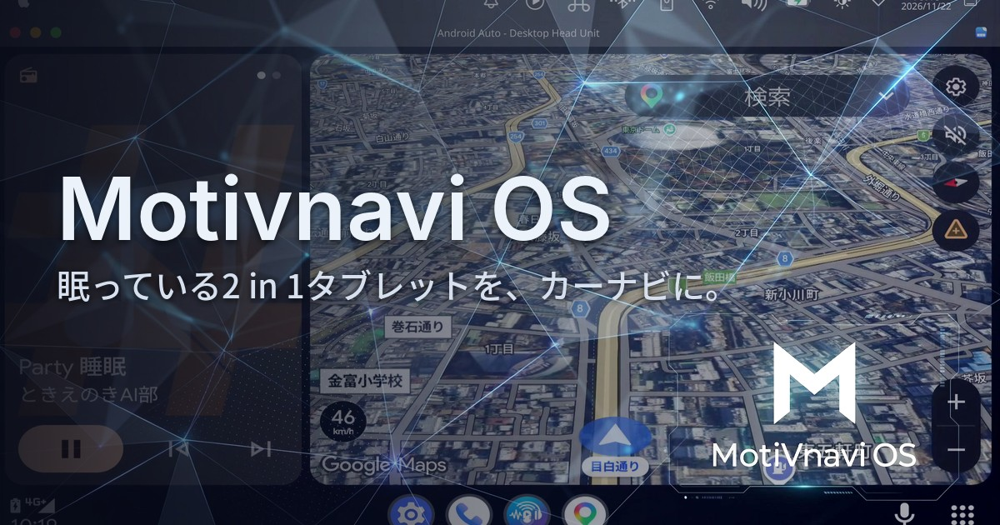
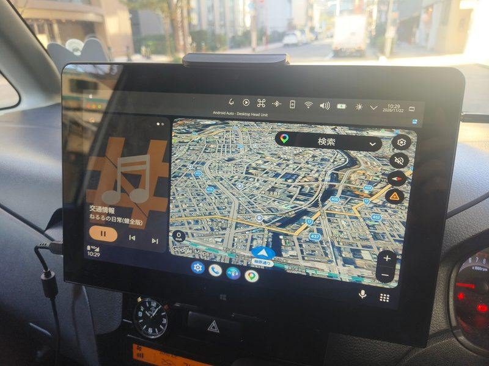
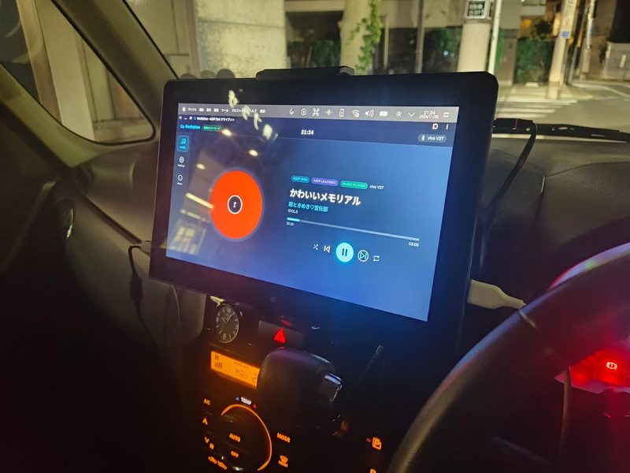
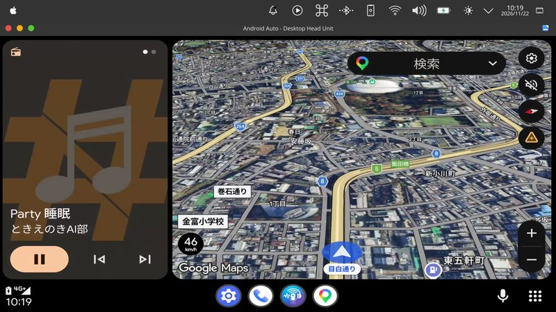
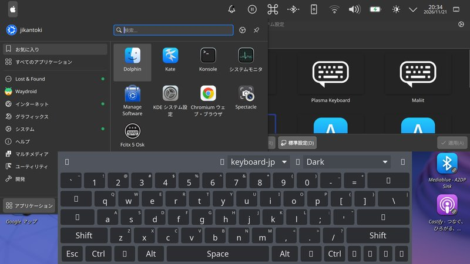
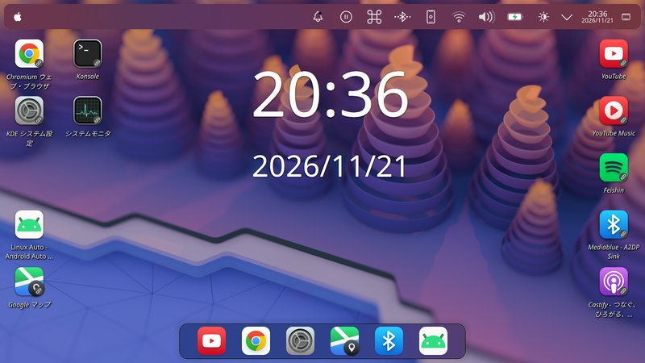

# Motivnavi OSへようこそ！



**眠っている2 in 1タブレットを、カーナビに。**

Motivnavi OSは、家に眠らせている中古の2 in 1タブレットをカーナビとして生まれ変わらせるべく発足したプロジェクトです。
日本人のエンジニアである **エノキ電気** によって作成されました。

このリポジトリは、Motivnavi OSの紹介ページ（PWA対応）のソースコードです。

🌐 **ホームページ：<https://motivnavi.enoki.xyz>**
⬇️ **ダウンロード：<https://motivnavi.enoki.xyz/download/>**

---

## 取り付けイメージ

| Android Auto | Mediablue |
| --- | --- |
|  |  |
| Linux AutoでAndroid Autoを表示。Googleマップでのナビと音楽再生を同時に。 | Mediablueで、Bluetooth接続したスマホの再生中の楽曲情報を表示。 |

## スクリーンショット

| Android Auto | アプリメニュー | ホーム画面 |
| --- | --- | --- |
|  |  |  |
| 音楽の再生とGoogleマップのナビを1画面で同時に表示。 | タッチだけでアプリの起動や文字入力ができます。 | 大きな時計と、よく使うアプリを並べて表示。 |

## 主な機能

- **充電中の画面点灯キープ**
  カーナビとして長時間画面を表示できるよう、充電中は画面を常に点灯。充電していない間はすぐに画面が暗くなり、最短でスリープに入ります。
- **スリープ自動復帰の阻止（ベータ）**
  2 in 1タブレットでありがちな、外部入力割り込みによるスリープの自動復帰を阻止。電源ボタンと充電開始でのみ復帰します。
- **Android Autoに対応**
  プリインストールの **Linux Auto** で、USB接続およびWi-FiテザリングでAndroid Autoを使用できます（初回起動時にGoogle SDKのインストールが必要です）。
- **日本語のタッチスクリーンキーボード標準搭載**
  Linuxでは導入が面倒な、日本語入力対応のタッチスクリーンキーボードを標準搭載。
- **Bluetoothで接続した端末からの楽曲再生に対応**
  スマホの音声をMotivnavi OSで再生でき、通話にも対応。**Mediablue** で再生中の楽曲情報も表示できます。
- **インターネットラジオプレイヤー同梱**
  AzuraCast規格に対応したインターネットラジオプレイヤー **Castify** を同梱しています。
- **KDEデスクトップを採用**
  タッチスクリーンとの相性と軽量さを考えて、**KDE Plasma** を採用しました。
- **アイコンの巨大化とウィンドウの自動最大化**
  運転中のタッチ操作でもストレスのないよう、アイコンは大きめ、ウィンドウはデフォルトで最大化されます。
- **欲しいアプリは何でもご自由に**
  標準的なLinuxからの派生OSなので、debファイルやaptコマンドでアプリをインストールできます。
- **Waydroidを入れればAndroidアプリも動く**
  別途 **Waydroid** をインストールすれば、Androidアプリも動作します。

## 動作環境

|  | 推奨動作環境 | 最低動作環境 |
| --- | --- | --- |
| 検証端末 | Lenovo ThinkPad Helix Ultrabook (2015) | Fujitsu Q506 |
| CPU | Intel Core M-5Y71 1.2GHz 2コア4スレッド | Atom x5-Z8500 1.4GHz 4コア4スレッド |
| メモリ | 4GB以上（ブラウザやWaydroidを多用する場合は8GB以上） | 4GB以上 |
| ストレージ | SSD 64GB以上 | eMMC 64GB以上 |

### その他必須要件

- x86-64（64ビット）に対応したチップセット（Arm不可）
- スマホと連携する場合は、Wi-Fi及びBluetooth通信環境
- Linuxドライバの関係で内蔵スピーカー/3.5mmジャックが利用できない端末は、USB-3.5mm DAC

> タッチディスプレイのない端末でもご利用いただけますが、タッチディスプレイ環境で使われることを前提に開発されています。

SIMスロットやGPSセンサーを搭載していると、さらに便利です。

## 関連リポジトリ

| 名前 | 説明 |
| --- | --- |
| [Castify](https://github.com/jikantoki/castify) | インターネットラジオ視聴クライアント |
| [Linux Auto](https://github.com/jikantoki/LinuxAuto) | LinuxでAndroid Autoを実行するためのGUI |
| [Mediablue](https://github.com/jikantoki/mediablue) | LinuxでBluetooth接続先のメディア再生情報を表示させるGUI |
| [Motivnavi Plymouth](https://github.com/jikantoki/motivnavi-plymouth) | Motivnavi OSの起動画面 |
| [Fcitx5 Osk](https://github.com/fortime/fcitx5-osk)（外部プロジェクト） | KDE Plasma環境で日本語タッチキーボードを使うためのプログラム |
| [About Motivnavi OS](https://github.com/jikantoki/about-motivnavi) | このWebサイト |

## 製作者

**エノキ電気**　何かあればお気軽にご連絡ください。

- Webサイト：<https://enoki.xyz>
- X（Twitter）：[@jikantoki](https://twitter.com/jikantoki)
- GitHub：[jikantoki](https://github.com/jikantoki)

---

## このWebサイトについて（開発者向け）

紹介ページは、Docker上のApacheで配信する静的サイトです（PWA対応）。

### 起動

```bash
docker compose up -d --build
```

ブラウザで <http://localhost:13080/> を開きます。停止は `docker compose down` です。

### ファイル構成

```
.
├── Dockerfile               # httpd:2.4-alpine ベース
├── docker-compose.yml       # 13080 → 80 にポート割り当て
├── apache/
│   └── motivnavi.conf       # MIMEタイプ・圧縮・キャッシュ制御
└── htdocs/
    ├── index.html           # トップページ
    ├── download/
    │   └── index.html       # ダウンロードページ（/download/）
    ├── manifest.webmanifest # PWA マニフェスト
    ├── sw.js                # Service Worker（オフライン対応）
    ├── css/style.css
    ├── js/app.js            # SW登録・背景スライド・機能名のタイプ表示・ハンバーガーメニュー・写真の拡大表示
    ├── icons/               # favicon / 192 / 512 / maskable / apple-touch / エノキ電気ロゴ
    └── images/
        ├── ogp.jpg / ogp.webp # OGP画像（トップページにも表示）
        ├── wallpaper/       # トップの背景スライド（3秒ごとに切り替え）
        ├── photos/          # 取り付けイメージ写真（800px / 1600px）
        ├── screenshots/     # スクリーンショット（800px / 1600px）
        └── pwa/             # PWA インストール画面用のスクリーンショット
```

### PWAとしてインストールする

- Chrome / Edge でページを開き、アドレスバーのインストールアイコンからインストールできます。
- 一度開けば、オフラインでも表示できます。

#### 注意：別の端末からアクセスする場合

Service Worker は **HTTPS か localhost** でしか動きません。
`http://192.168.x.x:13080/` のようにLAN内の別端末から開くと、ページは表示されますがPWAとしてはインストールできません。

別端末からインストールしたい場合は、次のどちらかを使ってください。

1. リバースプロキシ（Caddy / nginx など）や Cloudflare Tunnel で HTTPS 化する
2. テスト用途なら、Chrome の `chrome://flags/#unsafely-treat-insecure-origin-as-secure` に `http://<IPアドレス>:13080` を登録する

### 内容を更新したとき

`htdocs/sw.js` の `CACHE_VERSION`（例: `'v1'` → `'v2'`）を上げてから再ビルドすると、インストール済みのアプリにも新しい内容が反映されます。

```bash
docker compose up -d --build
```
